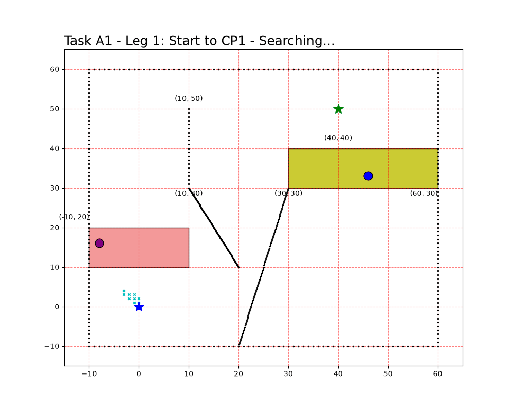

## Additional Task A1 — additional Checkpoints

A checkpoint is randomly generated **inside each cost-intensive area** which means every time the location of checkpoints are different ; the route is decided by A* algorithm, The path should follow `start → CP → CP → goal`.

** result**

| Checkpoint | coordination | Inside |
| --- | --- | --- |
| CP1 | (random in the area) | fuel-consuming area |
| CP2 | (random in the area) | time-consuming area |

Chosen order: `start → CP2 → CP1 → goal`, **total time 100(for example) .

---

## Additional Task A2 — Changing Environment

Each time there will be a new path as the environment keep changing for each operation.

| # | Requirement | Implementation |  |
| --- | --- | --- | --- |
| 1 | only the fuel area remain, randomly appeared with fixed 40×40 | `AREA_SIZE = 40`,  | 
| 2 | diagonal movement disabled, one grid per move | `ALLOW_DIAGONAL = False`, `STEP_COST = 1.0` |  |
| 3 | obstacles random, reasonable density | interior density 0.15 (border ring kept) |  |
| 4 | random start & goal, ≥40 units apart | rejection sampling on Euclidean distance |  |
| 5 | area plot must not cover obstacles; no obstacle at/near start & goal | obstacles drawn above the area (`zorder`); 3-cell clearance around both |  |

Example mission (`--seed 3`, fully reproducible): start (−6, 52), goal (47, 24), fuel area (7, 4)–(46, 43), interior density 0.140, start–goal distance 59.9, clearance 4, **T = 83.70 min**; the script prints a PASS/FAIL line for every requirement, and re-samples automatically if a mission has no feasible path.

*Figure 3 — Random mission, seed 3: yellow fuel area, black obstacles drawn on top, red planned path.*

